

### 17 free, interactive tools for Lean, continuous improvement, Six Sigma and Kaizen – organised along the improvement process.

**🇬🇧 English** · 🇩🇪 [Deutsch](#deutsch)

<a href="https://milad-karami.github.io/lean-ci-kaizen-tools/">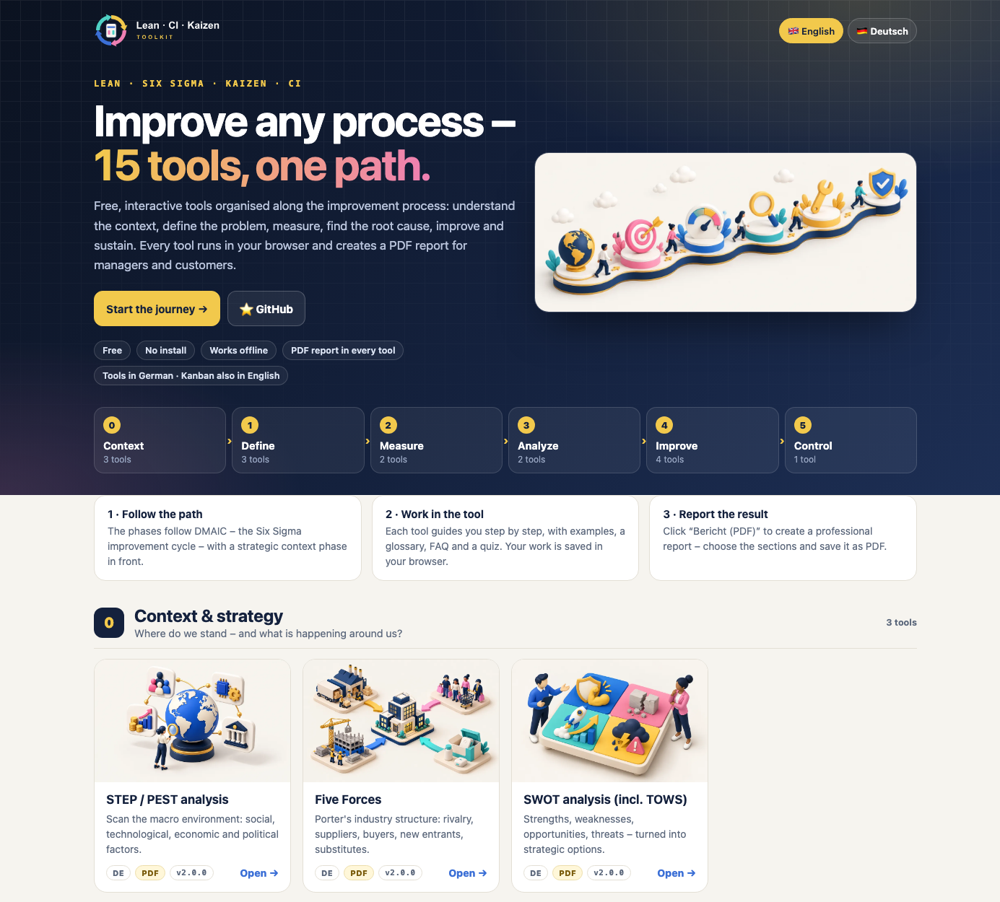</a>

## Why this toolkit

Improvement projects fail less often because of missing knowledge than because of missing structure. This toolkit puts 17
proven methods in the order you actually need them – from understanding the context to sustaining the result – and makes
each one hands-on: enter your own data, see the result immediately and hand over a clean PDF report.

- **Free and private** – runs completely in your browser, no account, no server, your data stays on your device
- **No installation** – every tool is a single HTML file that also works offline
- **Guided** – step-by-step mode, worked examples, glossary, FAQ and quiz in every tool
- **Report-ready** – 📄 PDF report with selectable sections; export as Markdown, JSON or Obsidian note
- **Bilingual** – Every tool in **English and German**

## The tools along the improvement process

The phases follow **DMAIC** – the Six Sigma improvement cycle – with a strategic context phase in front:
**0 Context** → **1 Define** → **2 Measure** → **3 Analyze** → **4 Improve** → **5 Control**. Click a picture to open the tool.

### 0 · Context & strategy
*Where do we stand – and what is happening around us?*

<table>
<tr><td width="33%" valign="top"> <b>STEP / PEST analysis</b> Scan the macro environment: social, technological, economic and political factors. <a href="https://milad-karami.github.io/lean-ci-kaizen-tools/tools/step-analyse-en.html"><b>Open</b></a> · <a href="https://milad-karami.github.io/lean-ci-kaizen-tools/tools/step-analyse.html">Deutsch</a> · <a href="changelog/step-analyse.md">v2.1.3</a></td><td width="33%" valign="top"> <b>Five Forces</b> Porter's industry structure: rivalry, suppliers, buyers, new entrants, substitutes. <a href="https://milad-karami.github.io/lean-ci-kaizen-tools/tools/five-forces-en.html"><b>Open</b></a> · <a href="https://milad-karami.github.io/lean-ci-kaizen-tools/tools/five-forces.html">Deutsch</a> · <a href="changelog/five-forces.md">v2.1.3</a></td><td width="33%" valign="top"> <b>SWOT analysis (incl. TOWS)</b> Strengths, weaknesses, opportunities, threats – turned into strategic options. <a href="https://milad-karami.github.io/lean-ci-kaizen-tools/tools/swot-analyse-en.html"><b>Open</b></a> · <a href="https://milad-karami.github.io/lean-ci-kaizen-tools/tools/swot-analyse.html">Deutsch</a> · <a href="changelog/swot-analyse.md">v2.1.3</a></td></tr>
</table>

### 1 · Define
*Which process, which problem, what does the customer need?*

<table>
<tr><td width="33%" valign="top"><b>DMAIC & DMADV</b> The two Six Sigma paths: improve what exists (DMAIC) or design something new (DMADV) – with project charter, metric and tollgates. <a href="https://milad-karami.github.io/lean-ci-kaizen-tools/tools/dmaic-dmadv-en.html"><b>Open</b></a> · <a href="https://milad-karami.github.io/lean-ci-kaizen-tools/tools/dmaic-dmadv.html">Deutsch</a> · <a href="changelog/dmaic-dmadv.md">v2.1.3</a></td><td width="33%" valign="top"> <b>SIPOC</b> Scope the process: suppliers, inputs, process steps, outputs, customers. <a href="https://milad-karami.github.io/lean-ci-kaizen-tools/tools/sipoc-en.html"><b>Open</b></a> · <a href="https://milad-karami.github.io/lean-ci-kaizen-tools/tools/sipoc.html">Deutsch</a> · <a href="changelog/sipoc.md">v2.1.3</a></td><td width="33%" valign="top"><a href="https://milad-karami.github.io/lean-ci-kaizen-tools/tools/kano-modell-en.html">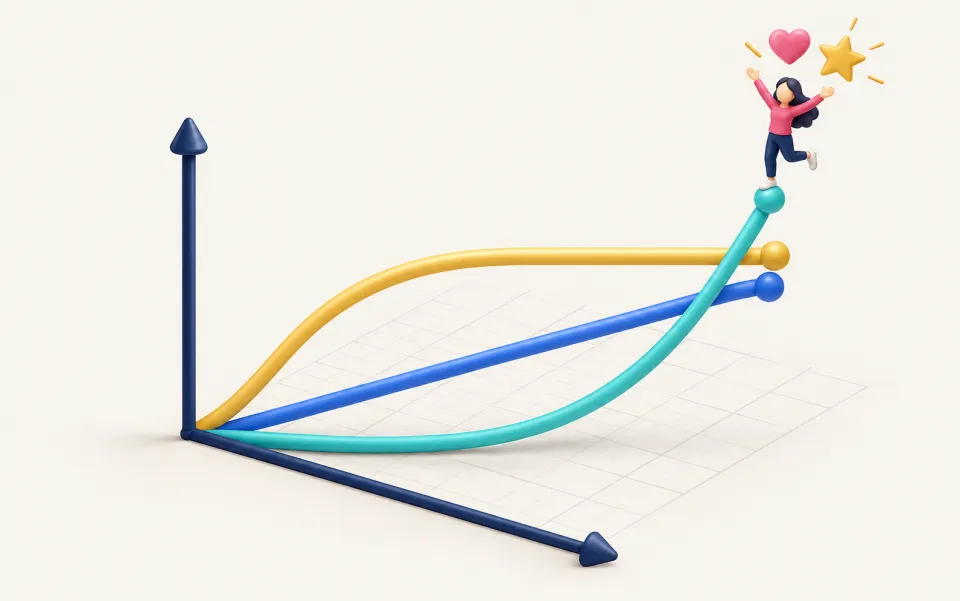</a> <b>Kano model</b> Classify customer requirements: basic, performance and delighter features. <a href="https://milad-karami.github.io/lean-ci-kaizen-tools/tools/kano-modell-en.html"><b>Open</b></a> · <a href="https://milad-karami.github.io/lean-ci-kaizen-tools/tools/kano-modell.html">Deutsch</a> · <a href="changelog/kano-modell.md">v2.1.3</a></td></tr>
<tr><td width="33%" valign="top"> <b>CTQ analysis</b> Translate the voice of the customer into measurable critical-to-quality specs. <a href="https://milad-karami.github.io/lean-ci-kaizen-tools/tools/ctq-analyse-en.html"><b>Open</b></a> · <a href="https://milad-karami.github.io/lean-ci-kaizen-tools/tools/ctq-analyse.html">Deutsch</a> · <a href="changelog/ctq-analyse.md">v2.1.3</a></td></tr>
</table>

### 2 · Measure
*How does the process really perform today – in numbers?*

<table>
<tr><td width="33%" valign="top"><a href="https://milad-karami.github.io/lean-ci-kaizen-tools/tools/prozess-begehung-en.html">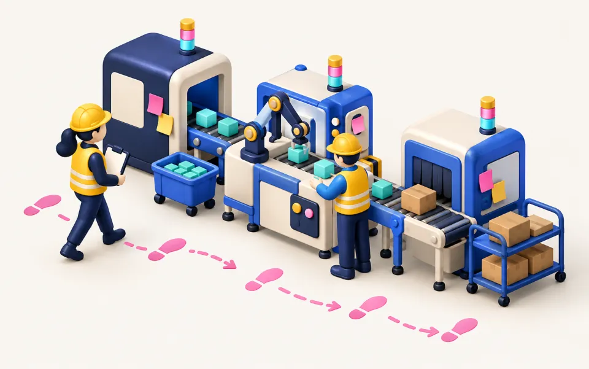</a> <b>Process walk-through (Gemba)</b> Capture the process on site: think in systems, observe, document. <a href="https://milad-karami.github.io/lean-ci-kaizen-tools/tools/prozess-begehung-en.html"><b>Open</b></a> · <a href="https://milad-karami.github.io/lean-ci-kaizen-tools/tools/prozess-begehung.html">Deutsch</a> · <a href="changelog/prozess-begehung.md">v2.1.3</a></td><td width="33%" valign="top"><a href="https://milad-karami.github.io/lean-ci-kaizen-tools/tools/oee-rechner-en.html">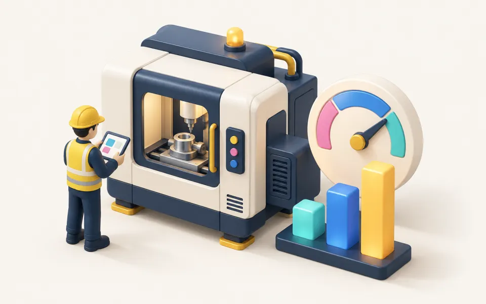</a> <b>OEE calculator</b> Overall equipment effectiveness = availability × performance × quality – with loss analysis. <a href="https://milad-karami.github.io/lean-ci-kaizen-tools/tools/oee-rechner-en.html"><b>Open</b></a> · <a href="https://milad-karami.github.io/lean-ci-kaizen-tools/tools/oee-rechner.html">Deutsch</a> · <a href="changelog/oee-rechner.md">v2.1.3</a></td><td width="33%" valign="top"><b>Process analysis (Toyota Kata)</b> Capture a line's current condition in five steps: output, customer takt, work patterns, equipment capacity, core work content. <a href="https://milad-karami.github.io/lean-ci-kaizen-tools/tools/prozess-analyse-en.html"><b>Open</b></a> · <a href="https://milad-karami.github.io/lean-ci-kaizen-tools/tools/prozess-analyse.html">Deutsch</a> · <a href="changelog/prozess-analyse.md">v2.1.3</a></td></tr>
</table>

### 3 · Analyze
*Where is the waste – and what is the root cause?*

<table>
<tr><td width="33%" valign="top"><a href="https://milad-karami.github.io/lean-ci-kaizen-tools/tools/wertstromanalyse-en.html">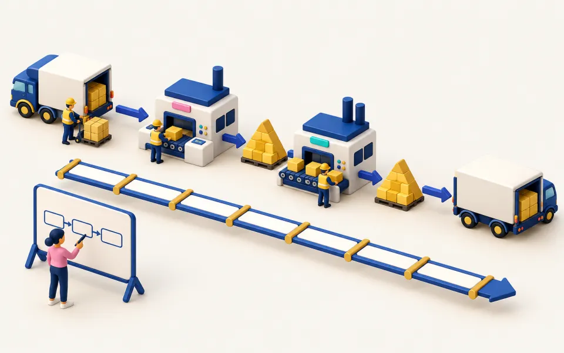</a> <b>Value stream mapping (current & future)</b> Make material and information flow visible, find lead time and waste. <a href="https://milad-karami.github.io/lean-ci-kaizen-tools/tools/wertstromanalyse-en.html"><b>Open</b></a> · <a href="https://milad-karami.github.io/lean-ci-kaizen-tools/tools/wertstromanalyse.html">Deutsch</a> · <a href="changelog/wertstromanalyse.md">v2.1.3</a></td><td width="33%" valign="top"> <b>Ishikawa diagram</b> Collect and rate causes systematically (6M) – instead of treating symptoms. <a href="https://milad-karami.github.io/lean-ci-kaizen-tools/tools/ishikawa-en.html"><b>Open</b></a> · <a href="https://milad-karami.github.io/lean-ci-kaizen-tools/tools/ishikawa.html">Deutsch</a> · <a href="changelog/ishikawa.md">v2.1.3</a></td></tr>
</table>

### 4 · Improve
*Which solution removes the cause – and how do we implement it?*

<table>
<tr><td width="33%" valign="top"><a href="https://milad-karami.github.io/lean-ci-kaizen-tools/tools/smed-rechner-en.html">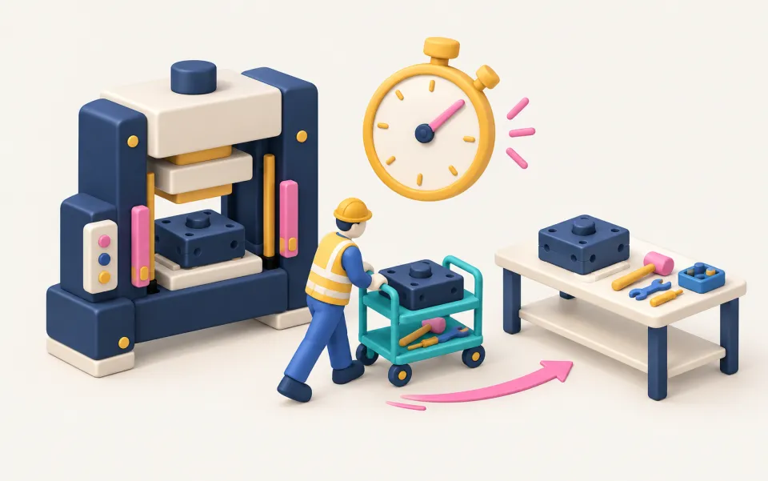</a> <b>SMED calculator</b> Cut changeover time: move internal to external steps, parallelise, standardise. <a href="https://milad-karami.github.io/lean-ci-kaizen-tools/tools/smed-rechner-en.html"><b>Open</b></a> · <a href="https://milad-karami.github.io/lean-ci-kaizen-tools/tools/smed-rechner.html">Deutsch</a> · <a href="changelog/smed-rechner.md">v2.1.3</a></td><td width="33%" valign="top"> <b>EPEI calculator</b> Every part every interval: derive lot size and supermarket from changeover and capacity. <a href="https://milad-karami.github.io/lean-ci-kaizen-tools/tools/epei-rechner-en.html"><b>Open</b></a> · <a href="https://milad-karami.github.io/lean-ci-kaizen-tools/tools/epei-rechner.html">Deutsch</a> · <a href="changelog/epei-rechner.md">v2.1.3</a></td><td width="33%" valign="top"><a href="https://milad-karami.github.io/lean-ci-kaizen-tools/tools/heijunka-en.html">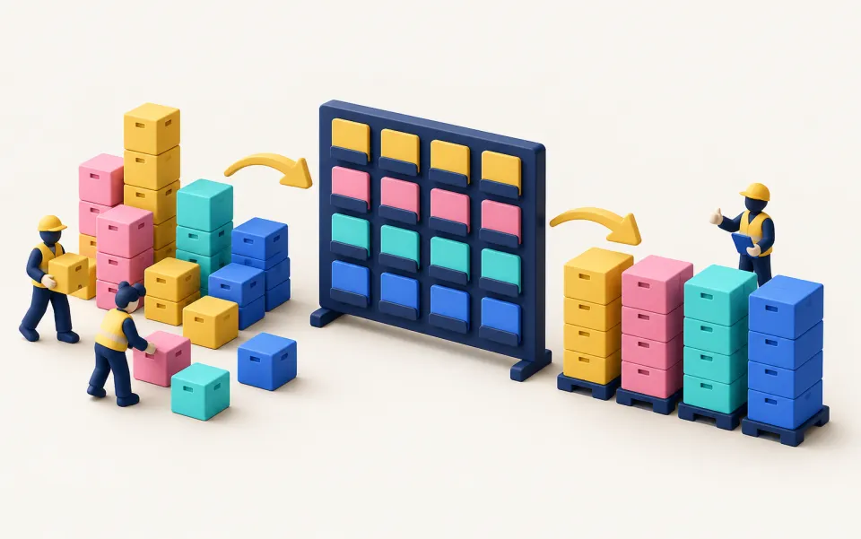</a> <b>Heijunka</b> Level production by volume and mix – a steady flow instead of waves. <a href="https://milad-karami.github.io/lean-ci-kaizen-tools/tools/heijunka-en.html"><b>Open</b></a> · <a href="https://milad-karami.github.io/lean-ci-kaizen-tools/tools/heijunka.html">Deutsch</a> · <a href="changelog/heijunka.md">v2.1.3</a></td></tr>
<tr><td width="33%" valign="top"><a href="https://milad-karami.github.io/lean-ci-kaizen-tools/tools/kanban-control-loops.html">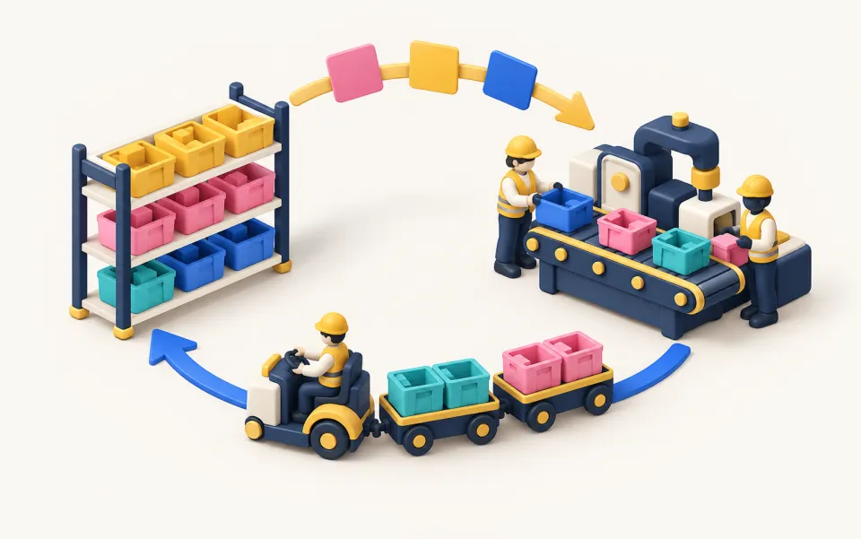</a> <b>Kanban control loops</b> Pull simulation with an animated factory, optimisation to zero shortages and changeover time. <a href="https://milad-karami.github.io/lean-ci-kaizen-tools/tools/kanban-control-loops.html"><b>Open</b></a> · <a href="https://milad-karami.github.io/lean-ci-kaizen-tools/tools/kanban-regelkreislauf.html">Deutsch</a> · <a href="changelog/kanban-regelkreislauf.md">v2.2.2</a></td></tr>
</table>

### 5 · Control
*How do we sustain the result – and keep improving?*

<table>
<tr><td width="33%" valign="top"> <b>PDCA cycle</b> Plan – Do – Check – Act: secure improvements, standardise and keep turning. <a href="https://milad-karami.github.io/lean-ci-kaizen-tools/tools/pdca-en.html"><b>Open</b></a> · <a href="https://milad-karami.github.io/lean-ci-kaizen-tools/tools/pdca.html">Deutsch</a> · <a href="changelog/pdca.md">v2.1.3</a></td></tr>
</table>

## Inside the tools

<table>
<tr><td width="50%" valign="top">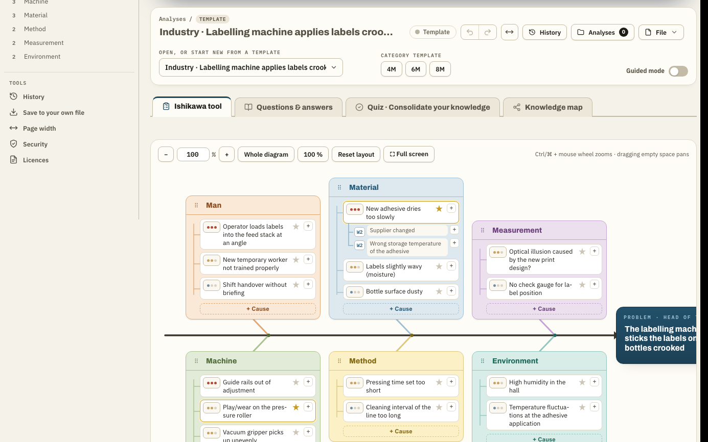 Ishikawa – causes by 6M, rated and prioritised</td><td width="50%" valign="top">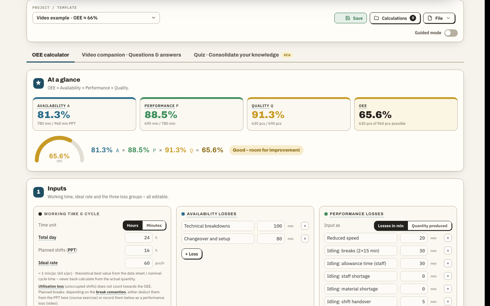 OEE – time cascade and loss analysis</td></tr>
<tr><td width="50%" valign="top">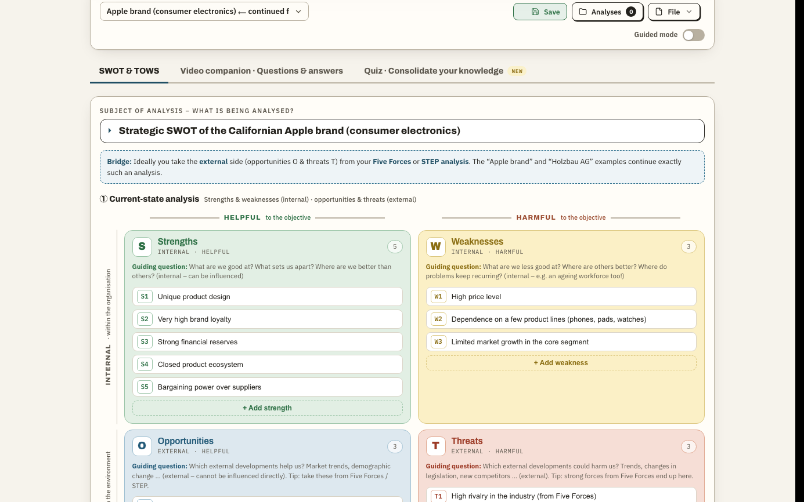 SWOT & TOWS – from factors to strategies</td><td width="50%" valign="top">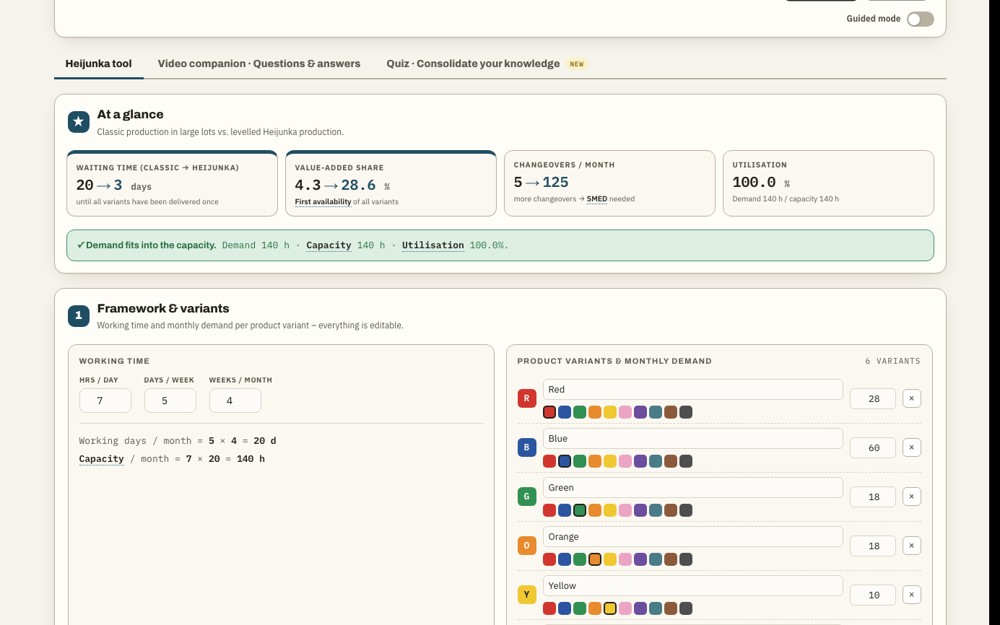 Heijunka – levelling volume and mix</td></tr>
<tr><td width="50%" valign="top">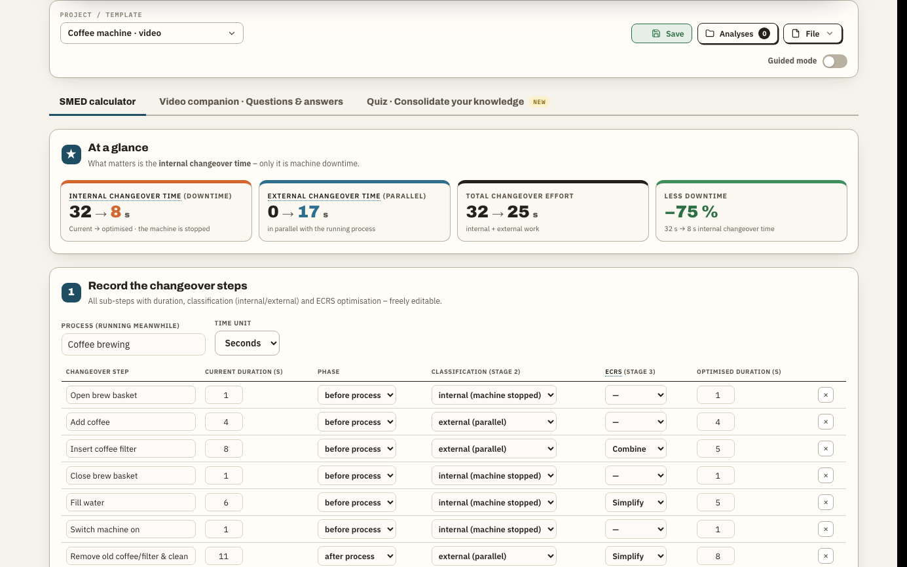 SMED – the three stages of changeover reduction</td><td width="50%" valign="top">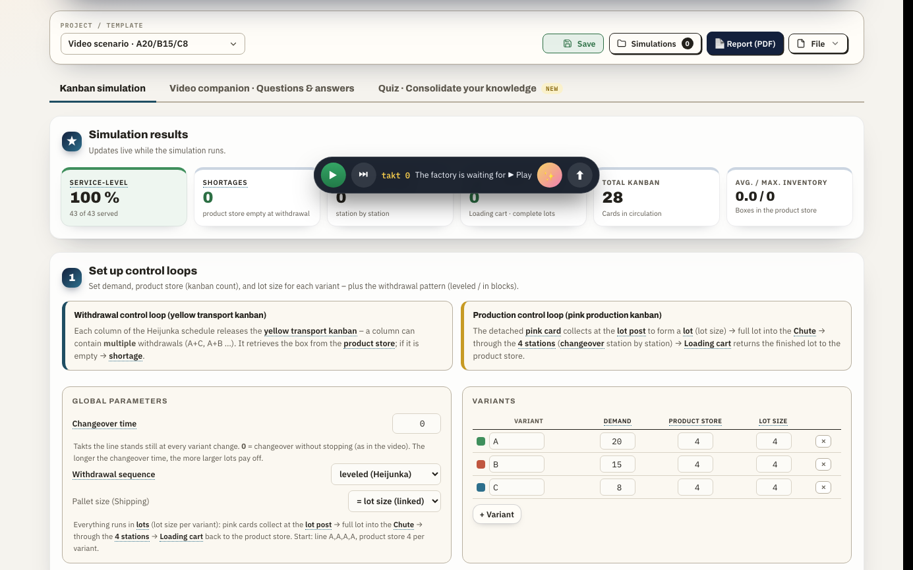 Kanban – live factory simulation</td></tr>
</table>

## How to use

1. **Online:** open the [live demo](https://milad-karami.github.io/lean-ci-kaizen-tools/) and pick a phase – or jump straight to a tool above.
2. **Work:** start from a worked example or an empty template; your work is saved automatically in your browser.
3. **Report:** click **📄 Report (PDF)**, choose the sections and select **Save as PDF** in the print dialog (best in Chrome or Edge).
4. **Offline:** download the complete toolkit from the [latest release](https://github.com/milad-karami/lean-ci-kaizen-tools/releases/latest) (zip) or any single file from [`tools/`](tools/) and double-click it.

## Versions & changelog

Every tool has its own version and change log – what changed and which bugs were fixed compared to the original:
see the version links above or the [`changelog/`](changelog/) folder. All versions, including the **unchanged originals (v1.0.0)**,
are available as single HTML files under [**Releases**](https://github.com/milad-karami/lean-ci-kaizen-tools/releases) (tags `<tool>-v<version>`, e.g. `oee-rechner-v1.0.0`).
The complete website is released as `toolkit-v<version>`.

## Origin, authorship & permission

- **Original tools:** John Naska, [mokka.solutions](https://www.mokka.solutions/) – created for a Lean / CI training course.
  The structure, content and logic of the original tools are his work.
- **Further development:** [Milad Karami](https://www.linkedin.com/in/milad-karami-63075b78/), October 2026 – toolkit structure along the improvement process,
  unified design, PDF report, English versions, versioning and bug fixes (documented per tool in [`changelog/`](changelog/)).
- Published **with the permission of John Naska**, crediting him by name and marking all changes.
- Subject-matter sources (videos, literature) are linked in each tool; all rights remain with their creators.

## License

This repository has **no open-source license**. All rights to the original tools remain with John Naska (mokka.solutions).
Using the tools for learning is explicitly welcome. If you pass them on or develop them further, please keep the chain of
origin visible: John Naska (mokka.solutions) → this version (Milad Karami), each with a short description of your own changes.

---

## Deutsch

**17 kostenlose, interaktive Werkzeuge für Lean, KVP, Six Sigma und Kaizen – geordnet entlang des Verbesserungsprozesses.**
[Live-Demo öffnen](https://milad-karami.github.io/lean-ci-kaizen-tools/) und oben rechts „🇩🇪 Deutsch“ wählen.

- **Kostenlos und privat** – läuft komplett im Browser, ohne Konto und Server; deine Daten bleiben auf deinem Gerät
- **Ohne Installation** – jedes Tool ist eine einzelne HTML-Datei und läuft auch offline
- **Geführt** – Schritt-für-Schritt-Modus, Beispiele, Glossar, FAQ und Quiz in jedem Tool
- **Berichtsfertig** – 📄 PDF-Bericht mit wählbaren Abschnitten; Export als Markdown, JSON oder Obsidian-Notiz
- **Zweisprachig** – Jedes Tool auf **Englisch und Deutsch**

### Die Werkzeuge entlang des Verbesserungsprozesses

Die Phasen folgen **DMAIC** mit vorgeschalteter Kontext-Phase: **0 Kontext** → **1 Define** → **2 Measure** → **3 Analyze** → **4 Improve** → **5 Control**.

| Phase | Werkzeug | Wofür | Öffnen | Version |
|---|---|---|---|---|
| 0 · Kontext | **STEP- / PEST-Analyse** | Makro-Umfeld systematisch scannen: soziale, technologische, ökonomische und politische Einflüsse. | [Öffnen](https://milad-karami.github.io/lean-ci-kaizen-tools/tools/step-analyse.html) · [English](https://milad-karami.github.io/lean-ci-kaizen-tools/tools/step-analyse-en.html) | [v2.1.3](changelog/step-analyse.md) |
| 0 · Kontext | **Five Forces** | Branchenstruktur nach Porter: Rivalität, Lieferanten, Kunden, neue Anbieter, Substitute. | [Öffnen](https://milad-karami.github.io/lean-ci-kaizen-tools/tools/five-forces.html) · [English](https://milad-karami.github.io/lean-ci-kaizen-tools/tools/five-forces-en.html) | [v2.1.3](changelog/five-forces.md) |
| 0 · Kontext | **SWOT-Analyse (inkl. TOWS)** | Stärken, Schwächen, Chancen, Risiken – und daraus strategische Optionen ableiten. | [Öffnen](https://milad-karami.github.io/lean-ci-kaizen-tools/tools/swot-analyse.html) · [English](https://milad-karami.github.io/lean-ci-kaizen-tools/tools/swot-analyse-en.html) | [v2.1.3](changelog/swot-analyse.md) |
| 1 · Define | **DMAIC & DMADV** | Die zwei Six-Sigma-Wege: Bestehendes verbessern (DMAIC) oder Neues entwerfen (DMADV) – mit Project Charter, Kennzahl und Tollgates. | [Öffnen](https://milad-karami.github.io/lean-ci-kaizen-tools/tools/dmaic-dmadv.html) · [English](https://milad-karami.github.io/lean-ci-kaizen-tools/tools/dmaic-dmadv-en.html) | [v2.1.3](changelog/dmaic-dmadv.md) |
| 1 · Define | **SIPOC** | Den Prozess abgrenzen: Lieferanten, Inputs, Prozessschritte, Outputs, Kunden. | [Öffnen](https://milad-karami.github.io/lean-ci-kaizen-tools/tools/sipoc.html) · [English](https://milad-karami.github.io/lean-ci-kaizen-tools/tools/sipoc-en.html) | [v2.1.3](changelog/sipoc.md) |
| 1 · Define | **Kano-Modell** | Kundenanforderungen einordnen: Basis-, Leistungs- und Begeisterungsmerkmale. | [Öffnen](https://milad-karami.github.io/lean-ci-kaizen-tools/tools/kano-modell.html) · [English](https://milad-karami.github.io/lean-ci-kaizen-tools/tools/kano-modell-en.html) | [v2.1.3](changelog/kano-modell.md) |
| 1 · Define | **CTQ-Analyse** | Die Stimme des Kunden in messbare, qualitätskritische Merkmale übersetzen. | [Öffnen](https://milad-karami.github.io/lean-ci-kaizen-tools/tools/ctq-analyse.html) · [English](https://milad-karami.github.io/lean-ci-kaizen-tools/tools/ctq-analyse-en.html) | [v2.1.3](changelog/ctq-analyse.md) |
| 2 · Measure | **Prozess-Begehung (Gemba)** | Den Prozess vor Ort erfassen: systemisch denken, beobachten, dokumentieren. | [Öffnen](https://milad-karami.github.io/lean-ci-kaizen-tools/tools/prozess-begehung.html) · [English](https://milad-karami.github.io/lean-ci-kaizen-tools/tools/prozess-begehung-en.html) | [v2.1.3](changelog/prozess-begehung.md) |
| 2 · Measure | **OEE-Rechner** | Gesamtanlageneffektivität = Verfügbarkeit × Leistung × Qualität – mit Verlustanalyse. | [Öffnen](https://milad-karami.github.io/lean-ci-kaizen-tools/tools/oee-rechner.html) · [English](https://milad-karami.github.io/lean-ci-kaizen-tools/tools/oee-rechner-en.html) | [v2.1.3](changelog/oee-rechner.md) |
| 2 · Measure | **Prozess-Analyse (Toyota Kata)** | Ist-Zustand einer Linie in fünf Schritten aufnehmen: Ausbringung, Kundentakt, Ablaufmuster, Anlagenkapazität, Kern-Arbeitsinhalt. | [Öffnen](https://milad-karami.github.io/lean-ci-kaizen-tools/tools/prozess-analyse.html) · [English](https://milad-karami.github.io/lean-ci-kaizen-tools/tools/prozess-analyse-en.html) | [v2.1.3](changelog/prozess-analyse.md) |
| 3 · Analyze | **Wertstromanalyse (IST & SOLL)** | Material- und Informationsfluss sichtbar machen, Durchlaufzeit und Verschwendung finden. | [Öffnen](https://milad-karami.github.io/lean-ci-kaizen-tools/tools/wertstromanalyse.html) · [English](https://milad-karami.github.io/lean-ci-kaizen-tools/tools/wertstromanalyse-en.html) | [v2.1.3](changelog/wertstromanalyse.md) |
| 3 · Analyze | **Ishikawa-Diagramm** | Ursachen strukturiert sammeln und bewerten (6M) – statt nur Symptome zu behandeln. | [Öffnen](https://milad-karami.github.io/lean-ci-kaizen-tools/tools/ishikawa.html) · [English](https://milad-karami.github.io/lean-ci-kaizen-tools/tools/ishikawa-en.html) | [v2.1.3](changelog/ishikawa.md) |
| 4 · Improve | **SMED-Rechner** | Rüstzeit verkürzen: interne in externe Schritte verlagern, parallelisieren, standardisieren. | [Öffnen](https://milad-karami.github.io/lean-ci-kaizen-tools/tools/smed-rechner.html) · [English](https://milad-karami.github.io/lean-ci-kaizen-tools/tools/smed-rechner-en.html) | [v2.1.3](changelog/smed-rechner.md) |
| 4 · Improve | **EPEI-Rechner** | Every Part Every Interval: Losgröße und Supermarkt aus Rüstzeit und Kapazität ableiten. | [Öffnen](https://milad-karami.github.io/lean-ci-kaizen-tools/tools/epei-rechner.html) · [English](https://milad-karami.github.io/lean-ci-kaizen-tools/tools/epei-rechner-en.html) | [v2.1.3](changelog/epei-rechner.md) |
| 4 · Improve | **Heijunka** | Produktion nach Menge und Variantenmix nivellieren – gleichmäßiger Fluss statt Wellen. | [Öffnen](https://milad-karami.github.io/lean-ci-kaizen-tools/tools/heijunka.html) · [English](https://milad-karami.github.io/lean-ci-kaizen-tools/tools/heijunka-en.html) | [v2.1.3](changelog/heijunka.md) |
| 4 · Improve | **Kanban-Regelkreisläufe** | Pull-Simulation mit animierter Fabrik, Optimierung auf 0 Fehlmengen und Rüstzeit. | [Öffnen](https://milad-karami.github.io/lean-ci-kaizen-tools/tools/kanban-regelkreislauf.html) · [English](https://milad-karami.github.io/lean-ci-kaizen-tools/tools/kanban-control-loops.html) | [v2.2.2](changelog/kanban-regelkreislauf.md) |
| 5 · Control | **PDCA-Zyklus** | Plan – Do – Check – Act: Verbesserungen absichern, standardisieren und weiterdrehen. | [Öffnen](https://milad-karami.github.io/lean-ci-kaizen-tools/tools/pdca.html) · [English](https://milad-karami.github.io/lean-ci-kaizen-tools/tools/pdca-en.html) | [v2.1.3](changelog/pdca.md) |

### Einblick in die Tools

<table>
<tr><td width="50%" valign="top"> Ishikawa – Ursachen nach 6M, bewertet und priorisiert</td><td width="50%" valign="top"> OEE – Zeitkaskade und Verlustanalyse</td></tr>
<tr><td width="50%" valign="top"> SWOT & TOWS – von Faktoren zu Strategien</td><td width="50%" valign="top"> Heijunka – Menge und Mix nivellieren</td></tr>
<tr><td width="50%" valign="top"> SMED – die drei Stufen der Rüstzeitreduzierung</td><td width="50%" valign="top"> Kanban – Fabrik-Simulation live</td></tr>
</table>

### Nutzung

1. **Online:** [Live-Demo](https://milad-karami.github.io/lean-ci-kaizen-tools/) öffnen und eine Phase wählen – oder oben direkt ein Tool öffnen.
2. **Arbeiten:** mit einem Beispiel oder einer leeren Vorlage starten; der Stand wird automatisch im Browser gespeichert.
3. **Bericht:** „📄 Bericht (PDF)“ → Abschnitte wählen → im Druckdialog „Als PDF sichern“ (am besten in Chrome oder Edge).
4. **Offline:** das komplette Toolkit aus dem [neuesten Release](https://github.com/milad-karami/lean-ci-kaizen-tools/releases/latest) (zip) oder eine einzelne Datei aus [`tools/`](tools/) herunterladen und per Doppelklick öffnen.

### Versionen & Änderungsprotokoll

Jedes Tool hat eine eigene Version und ein eigenes Änderungsprotokoll – was sich gegenüber dem Original geändert hat und welche
Fehler behoben wurden: siehe die Versions-Links oben oder den Ordner [`changelog/`](changelog/). Alle Versionen, auch die
**unveränderten Originale (v1.0.0)**, gibt es als einzelne HTML-Datei unter [**Releases**](https://github.com/milad-karami/lean-ci-kaizen-tools/releases).

### Herkunft, Urheberschaft & Genehmigung

- **Original-Tools:** John Naska, [mokka.solutions](https://www.mokka.solutions/) – erstellt für einen Lean-/KVP-Kurs.
- **Weiterentwicklung:** [Milad Karami](https://www.linkedin.com/in/milad-karami-63075b78/), Oktober 2026 – Toolkit-Struktur, einheitliches Design, PDF-Bericht,
  englische Fassungen, Versionierung und Fehlerkorrekturen.
- Veröffentlicht **mit Genehmigung von John Naska**, unter Nennung seines Namens und mit Kennzeichnung aller Änderungen.

### Lizenz

Keine Open-Source-Lizenz. Die Rechte an den Original-Tools liegen bei John Naska (mokka.solutions). Die Nutzung zum Lernen ist
ausdrücklich erwünscht. Bei Weitergabe bitte die Herkunftskette nennen: John Naska (mokka.solutions) → diese Fassung (Milad Karami).
