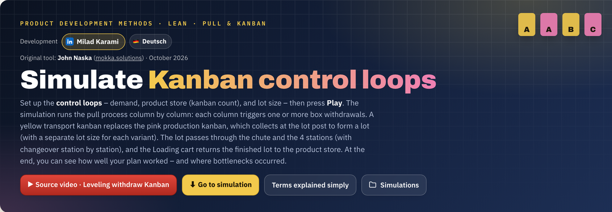
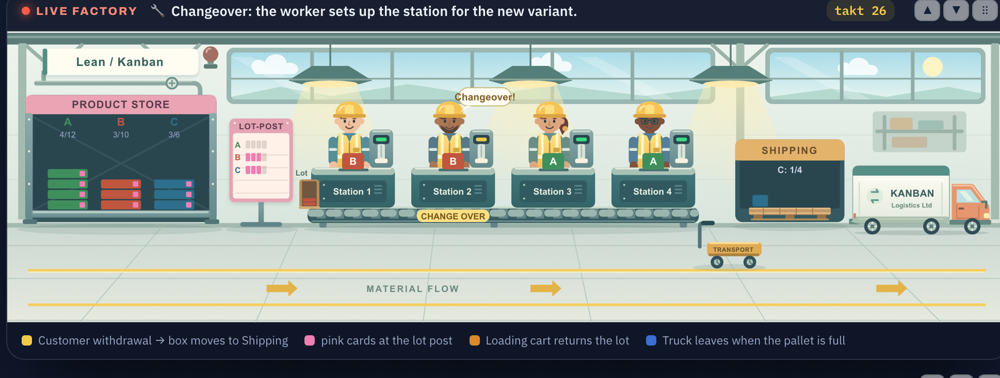
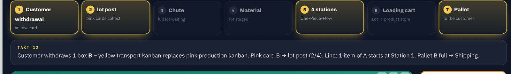
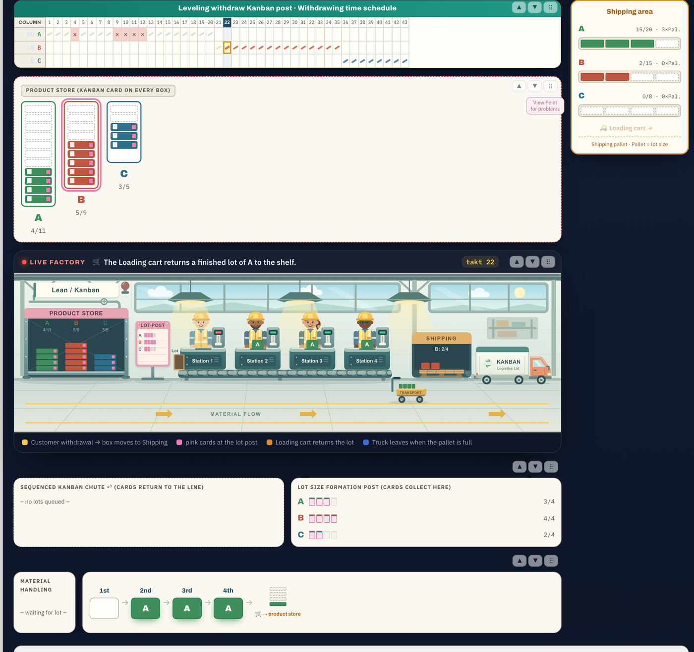
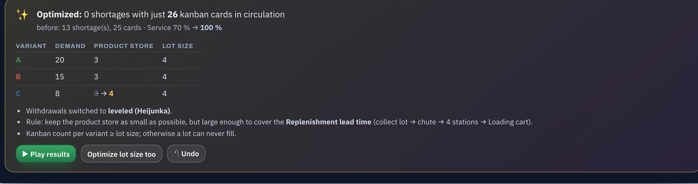
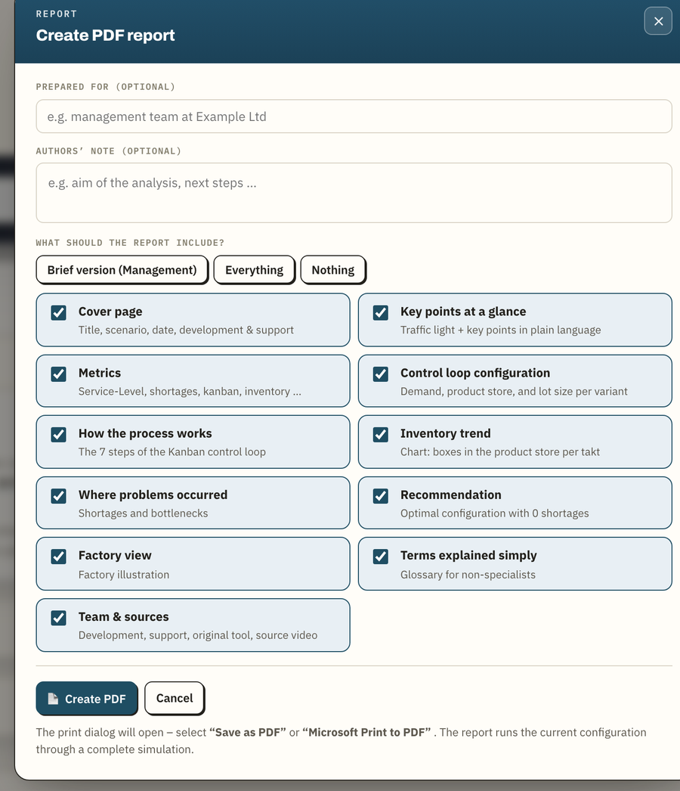
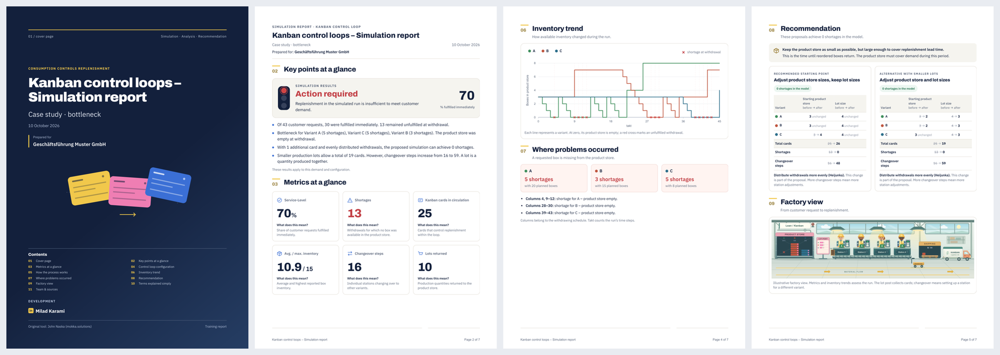

# Lean · CI · Kaizen – interactive learning tools

**Free, browser-based simulations for learning Lean, continuous improvement (CI) and Kaizen. No installation, no account, works offline.**

**🇬🇧 English** · 🇩🇪 [Deutsch](#deutsch)

## Tools

| Tool | What you learn | 🇬🇧 English | 🇩🇪 Deutsch |
|---|---|---|---|
| **Kanban control loops** | How a leveled pull system (Heijunka) replenishes stock, why shortages happen and how to size kanban loops | [**Open**](https://milad-karami.github.io/lean-ci-kaizen-tools/kanban-control-loops.html) | [Öffnen](https://milad-karami.github.io/lean-ci-kaizen-tools/kanban-regelkreislauf.html) |

More tools are on the way.

---

## Kanban control loops – a guided tour

The tool simulates a **leveling withdrawal kanban**, step by step:
customer withdrawal → lot size formation post → sequenced kanban chute → 4 stations (one-piece flow) → loading cart → product store → shipping.
You set demand, product store size (number of kanban cards) and lot size, press **▶ Play** and watch the loop work. Or watch it break.

### 🏭 Live factory: see what the numbers mean

An animated factory scene runs in sync with the simulation. Workers move when their station is busy, the “Changeover!” bubble appears when a new variant arrives, the loading cart brings finished lots back, boxes fly to shipping, the truck leaves when a pallet is full, and an alarm goes off on a shortage.

### 🧭 Step-by-step flow with live explanation

A 7-step flow bar highlights what is happening right now, and a plain-language narration explains every takt.

### 📋 The full board: schedule, product store, chute, lot post, line

Everything from the original training board in one place. Shortages are marked in red in the withdrawing schedule. Every section can be rearranged by **drag & drop**.

Show the full board

### ✨ Optimize: zero shortages with the fewest cards

One click searches for the smallest number of kanban cards that still serves every customer request. It can optionally optimize the lot size too, explains the rule behind the result, and has *Undo* and *Play results* buttons.

### 📄 PDF report for managers and customers

Choose what goes into the report: cover page, management summary with traffic light, KPIs explained in plain language, configuration, process diagram, inventory chart, problems, recommendation, factory view, glossary and sources. Then save it as a PDF.

  
  &nbsp;
  

### More features

- Pallet size freely selectable or coupled to the lot size
- Four ready-made scenarios (video scenario, balanced case, bottleneck case, your own scenario)
- Floating mini player; the page stays scrollable while the simulation runs
- Glossary (“terms explained simply”), FAQ and a quiz
- Save and load simulations; export as Markdown, JSON or Obsidian note
- English and German version, linked to each other

## How to use

- **Online:** open the [live demo](https://milad-karami.github.io/lean-ci-kaizen-tools/).
- **Offline:** download [`kanban-control-loops.html`](kanban-control-loops.html) (English) or [`kanban-regelkreislauf.html`](kanban-regelkreislauf.html) (German) and double-click it. It works in Chrome, Edge, Firefox and Safari.
- **PDF report:** click **📄 Report (PDF)**, select sections, then choose **Save as PDF** in the print dialog. Chrome and Edge give the best result.

## Origin, authorship & permission

- **Original tool:** John Naska, [mokka.solutions](https://www.mokka.solutions/). The structure, simulation logic and interface of the original tool are his work.
- **Subject-matter basis:** explainer video [“Leveling withdraw Kanban”](https://www.youtube.com/watch?v=buD22g8wNWw). The video is only linked, not embedded or copied. All rights remain with its creators.
- **Further development:** [Milad Karami](https://www.linkedin.com/in/milad-karami-63075b78/), October 2026.
- Published **with the permission of John Naska**, crediting him by name and marking all changes.

<b>Changes compared to the original</b>

**2026-10-09**
- Logic bugs fixed:
  - pallet size selectable instead of a fixed 4
  - the line keeps flowing when there are gaps
  - deadlock detection when the number of kanban cards is smaller than the lot size
  - the shortage verdict is only “green” at zero shortages
  - the safety limit scales with demand
- New “✨ Optimize” function (zero shortages with the minimum number of kanban cards)
- Animated factory scene with cartoon illustrations, live narration, 7-step flow bar
- PDF report with selectable sections
- Drag & drop of sections, mini player; the page stays scrollable while playing

**2026-10-10**
- English version of the tool; English is now the default, German stays available

## License

This repository has **no open-source license**. All rights to the original tool remain with John Naska (mokka.solutions).
Using the tools for learning is explicitly welcome. If you develop the tool further or pass it on, please keep the chain of origin visible: video → John Naska (mokka.solutions) → this version (Milad Karami), each with the date and a short description of your own changes.

---

## Deutsch

**Kostenlose Lern-Simulationen zu Lean, KVP und Kaizen, direkt im Browser. Ohne Installation, ohne Konto, auch offline.**

| Werkzeug | Deutsch | Englisch |
|---|---|---|
| **Kanban-Regelkreisläufe simulieren** | [**Öffnen**](https://milad-karami.github.io/lean-ci-kaizen-tools/kanban-regelkreislauf.html) | [Open](https://milad-karami.github.io/lean-ci-kaizen-tools/kanban-control-loops.html) |

### Funktionen

- Pull-Simulation eines Leveling-Withdraw-Kanban (Heijunka): Entnahme → Lot-Post → Chute → 4 Stationen (One-Piece-Flow) → Loading cart → Versand
- Animierte Szene „Fabrik live“: Werker, Rüstwechsel, Loading cart, LKW, Fehlmengen-Alarm
- Schritt-für-Schritt-Ablauf mit Live-Erklärung
- **✨ Optimieren:** kleinste Kanban-Anzahl mit 0 Fehlmengen (optional auch die Losgröße)
- **📄 PDF-Bericht** für Führungskräfte und Kunden mit wählbaren Inhalten
- Bereiche per Drag & Drop, Mini-Player, Glossar, FAQ, Quiz, Speichern und Export

Die Screenshots oben zeigen die englische Fassung. Die deutsche Fassung ist inhaltlich identisch.

### Nutzung

- **Online:** [Live-Demo](https://milad-karami.github.io/lean-ci-kaizen-tools/) öffnen und oben rechts „🇩🇪 Deutsch“ wählen.
- **Offline:** [`kanban-regelkreislauf.html`](kanban-regelkreislauf.html) herunterladen und per Doppelklick öffnen.
- **PDF-Bericht:** „📄 Bericht (PDF)“ → Inhalte wählen → im Druckdialog „Als PDF sichern“.

### Herkunft, Urheberschaft & Genehmigung

- **Original-Tool:** John Naska, [mokka.solutions](https://www.mokka.solutions/)
- **Fachliche Grundlage:** Erklärvideo [„Leveling withdraw Kanban“](https://www.youtube.com/watch?v=buD22g8wNWw). Das Video ist nur verlinkt. Die Rechte daran liegen bei den jeweiligen Urheberinnen und Urhebern.
- **Weiterentwicklung:** [Milad Karami](https://www.linkedin.com/in/milad-karami-63075b78/), Oktober 2026
- Veröffentlicht **mit Genehmigung von John Naska**, unter Nennung seines Namens und mit Kennzeichnung der Änderungen (siehe „Changes compared to the original“ oben).

### Lizenz

Keine Open-Source-Lizenz. Die Rechte am Original-Tool liegen bei John Naska (mokka.solutions). Die Nutzung zum Lernen ist ausdrücklich erwünscht. Bei Weitergabe bitte die Herkunftskette nennen: Video → John Naska (mokka.solutions) → diese Fassung (Milad Karami).
